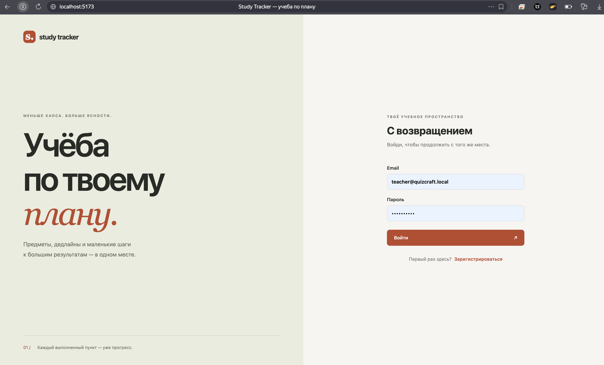
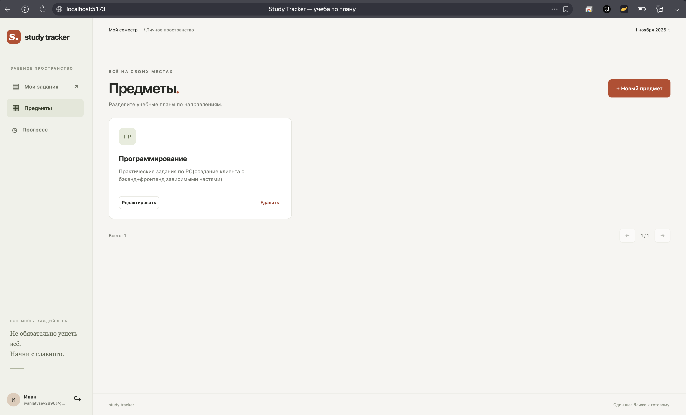
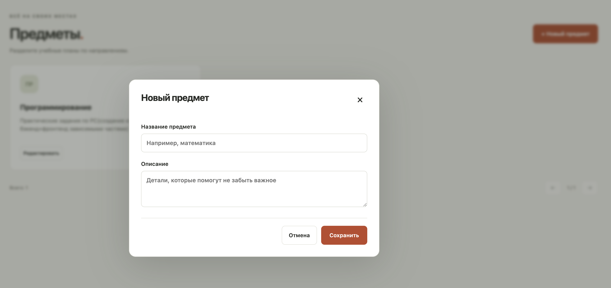
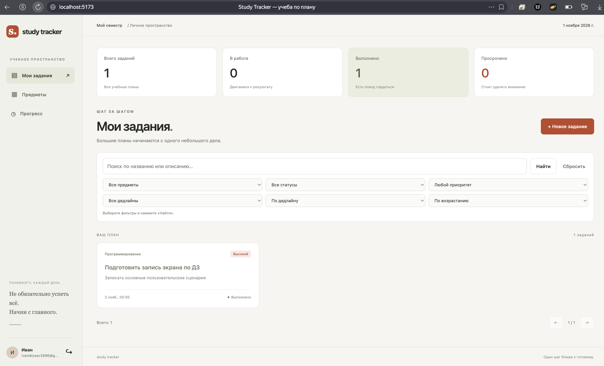
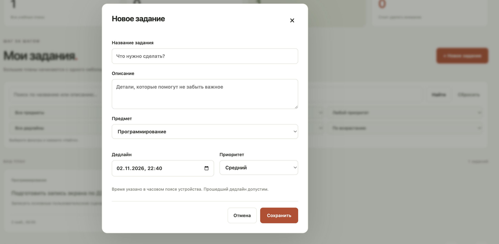
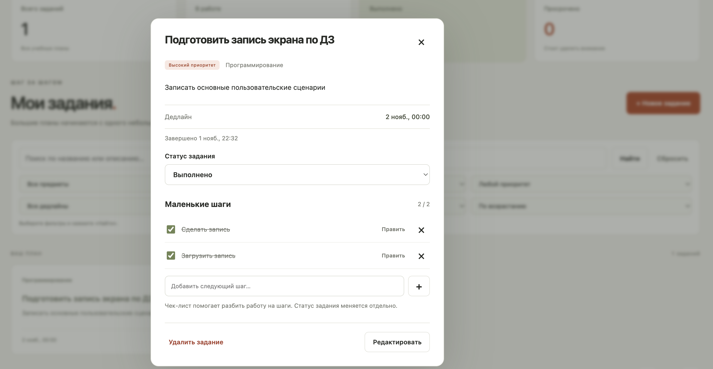
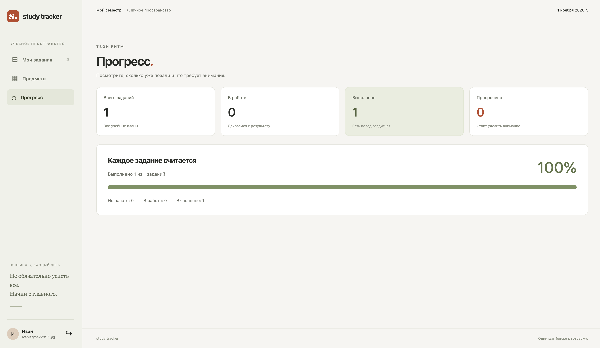

# Study Tracker

Клиент-серверное приложение для учёта учебных заданий. Пользователь ведёт предметы, создаёт задания с дедлайнами и приоритетами, составляет чек-листы и отслеживает выполнение. Данные каждого пользователя доступны только ему.

Клиент на React работает с REST API сервера FastAPI. Все данные сохраняются на сервере в PostgreSQL. Ближайшие дедлайны отображаются в интерфейсе; отправки email и push-уведомлений нет.

## Стек

- React 19, Vite 8, JavaScript, CSS, Fetch API.
- Python 3.12, FastAPI, Uvicorn.
- PostgreSQL 17, SQLAlchemy 2, Alembic.
- Pydantic 2 для валидации данных, Argon2id для хеширования паролей.
- pytest и HTTPX для тестирования, Ruff для проверки кода.
- Docker Compose для запуска клиента, API и базы; Nginx для раздачи клиента и проксирования API.
- Playwright для сквозных проверок интерфейса в Chromium.

Прямые зависимости сервера и тестов находятся в одном `requirements.txt`. Зависимости клиента описаны в `client/package.json`, точное дерево зафиксировано в `client/package-lock.json`.

## Реализованные возможности клиента

- Регистрация, вход и выход с отзывом токена. Сессия сохраняется при перезагрузке страницы; при истечении токена отображается форма входа.
- Создание, просмотр, редактирование и удаление предметов. Сервер запрещает удаление предмета с заданиями, клиент показывает причину.
- Создание заданий, просмотр подробностей, редактирование названия, описания, предмета, приоритета и срока, удаление с подтверждением.
- Переключение статусов «Не начато», «В работе», «Выполнено» и отображение времени завершения.
- Поиск, совместная фильтрация по предмету, статусу, приоритету и дедлайну, сортировка и постраничный просмотр.
- Просроченные задания и ближайшие дедлайны за 1–30 дней.
- Чек-листы: добавление, редактирование текста и порядка, отметка выполнения и удаление пунктов.
- Статистика и процент выполнения, обновляемые после изменений.
- Проверка обязательных полей, email, длины пароля, названий, описаний и диапазонов чисел. Названия из пробелов не принимаются.
- Состояния загрузки и пустых списков, сообщения об ошибках сервера/сети, повторная загрузка и блокировка повторной отправки форм.
- Адаптивный интерфейс для компьютера и телефона, подписи полей, управление диалогами с клавиатуры.

Токен хранится в `sessionStorage` текущей вкладки и передаётся в заголовке Authorization. Данные предметов и заданий не сохраняются в хранилище браузера. Даты вводятся в часовом поясе устройства, передаются в API в UTC и отображаются снова в местном времени.

## Функциональные требования

| ID | Требование |
|---|---|
| Ф1 | Регистрация пользователя по имени, email и паролю. Повторная регистрация на тот же email запрещена. |
| Ф2 | Вход по email и паролю, выдача токена доступа и выход с аннулированием текущего токена. |
| Ф3 | Создание, просмотр, изменение и удаление предметов. Удаление предмета с заданиями возвращает ошибку. |
| Ф4 | Создание задания с названием, описанием, предметом, сроком сдачи и приоритетом: низкий, средний или высокий. |
| Ф5 | Получение списка заданий и отдельного задания, редактирование его полей и удаление. |
| Ф6 | Изменение статуса: «Не начато», «В работе», «Выполнено». При завершении сохраняется время выполнения, при повторном открытии — очищается. |
| Ф7 | Поиск по названию и описанию, фильтрация по предмету, статусу и приоритету, сортировка по дедлайну и приоритету. |
| Ф8 | Добавление, редактирование и удаление пунктов чек-листа, отметка их выполнения. Статус задания изменяется отдельно. |
| Ф9 | Получение просроченных заданий и незавершённых заданий с дедлайном в ближайшие N дней, где N от 1 до 30. |
| Ф10 | Статистика: общее количество заданий, количество по каждому статусу, просроченные и процент выполненных. |

## Нефункциональные требования

| ID | Требование |
|---|---|
| НФ1 | Пользователь имеет доступ только к своим предметам, заданиям, чек-листам и статистике. Запрос чужого объекта по ID возвращает `404`. |
| НФ2 | Пароли хранятся в виде Argon2id-хешей. Пароли и токены не записываются в журналы приложения; в БД хранится только хеш токена. |
| НФ3 | Сервер проверяет обязательные поля, email, статусы и приоритеты. Название задания — 1–200 символов, описание — до 10 000; название из одних пробелов недопустимо. |
| НФ4 | Данные сохраняются в PostgreSQL и остаются доступными после перезапуска приложения и контейнеров без удаления тома БД. |
| НФ5 | Связанные изменения выполняются в транзакции и откатываются при ошибке. Пункты чек-листа без задания недопустимы. |
| НФ6 | При обычной работе одного пользователя не менее 95% запросов списка заданий обрабатываются сервером не дольше 500 мс при наличии 1 000 заданий у пользователя. Время передачи данных по сети не учитывается. |
| НФ7 | Списки заданий поддерживают пагинацию: 20 записей по умолчанию, максимум 100 на страницу, с указанием общего количества найденных записей. |
| НФ8 | Обмен данными происходит по HTTP в JSON. Ошибки имеют единый формат с кодом и сообщением; внутренние трассировки клиенту не передаются. |
| НФ9 | Все прикладные методы API описаны в автоматически формируемой OpenAPI-схеме и доступны через Swagger UI. README содержит сведения о проекте, требованиях, эндпоинтах, запуске и тестировании. |
| НФ10 | После заполнения `.env` проект запускается командой `docker compose up --build`. Версии прямых зависимостей сервера и дерево зависимостей клиента зафиксированы, структура БД создаётся миграциями Alembic. |

## Эндпоинты

Префикс прикладных методов — `/api/v1`. Регистрация и вход доступны без токена. Остальные прикладные методы требуют заголовок `Authorization: Bearer <access_token>`.

| Метод | Путь | Назначение |
|---|---|---|
| POST | `/auth/register` | Регистрация: `name`, `email`, `password` |
| POST | `/auth/login` | Вход: `email`, `password`; возвращает токен и срок действия |
| POST | `/auth/logout` | Отзыв текущего токена |
| GET | `/auth/me` | Текущий пользователь |
| GET | `/subjects` | Список предметов |
| POST | `/subjects` | Создание предмета: `name`, `description` |
| GET | `/subjects/{subject_id}` | Получение предмета |
| PATCH | `/subjects/{subject_id}` | Изменение предмета |
| DELETE | `/subjects/{subject_id}` | Удаление предмета без заданий |
| GET | `/tasks` | Список заданий с поиском, фильтрами и сортировкой |
| POST | `/tasks` | Создание задания |
| GET | `/tasks/{task_id}` | Получение задания |
| PATCH | `/tasks/{task_id}` | Изменение полей задания |
| DELETE | `/tasks/{task_id}` | Удаление задания вместе с чек-листом |
| PATCH | `/tasks/{task_id}/status` | Изменение статуса |
| GET | `/tasks/{task_id}/checklist` | Список пунктов чек-листа |
| POST | `/tasks/{task_id}/checklist` | Добавление пункта: `title`, `position` |
| PATCH | `/tasks/{task_id}/checklist/{item_id}` | Изменение `title`, `position`, `is_completed` |
| DELETE | `/tasks/{task_id}/checklist/{item_id}` | Удаление пункта |
| GET | `/stats` | Статистика пользователя |

Служебные адреса без префикса: `/health` — состояние процесса, `/health/ready` — доступность БД, `/docs` — Swagger UI, `/openapi.json` — схема API.

При создании задания обязательны `subject_id`, `title`, `due_at`. Необязательные поля: `description` (по умолчанию пустая строка), `priority` (по умолчанию `medium`). Начальный статус — `todo`.

Статусы: `todo`, `in_progress`, `done`. Приоритеты: `low`, `medium`, `high`. Даты передаются с часовым поясом, например `2027-05-10T18:00:00+03:00`; ответы используют UTC. Для изменения статуса передайте `{"status":"done"}` в соответствующий PATCH-метод. Повторная установка `done` сохраняет время завершения.

Параметры `GET /tasks`:

| Параметр | Значения |
|---|---|
| `q` | Поиск по названию и описанию без учёта регистра |
| `subject_id`, `status`, `priority` | Фильтры; применяются совместно |
| `sort` | `due_at`, `priority`, `created_at`; по умолчанию `due_at` |
| `order` | `asc` или `desc`; по умолчанию `asc` |
| `deadline` | `overdue` или `upcoming` |
| `days` | От 1 до 30, по умолчанию 7; используется с `upcoming` |
| `page`, `page_size` | Номер страницы от 1 и размер от 1 до 100 |

Просроченным считается незавершённое задание с прошедшим дедлайном. Ближайшие задания имеют срок от текущего момента до текущего момента плюс N суток включительно. Завершённые задания не попадают в эти выборки.

Ответы списков содержат `items`, `total`, `page`, `page_size`. PATCH принимает хотя бы одно изменяемое поле, `null` запрещён. Основные ошибки: `401` — проблема с авторизацией, `404` — объект недоступен, `409` — конфликт данных, `422` — ошибка валидации, `503` — БД недоступна, `500` — внутренняя ошибка. Формат ошибки: `{"error":{"code":"...","message":"..."},"request_id":"..."}`.

## Запуск через Docker

Требуется Docker с Compose v2. В корне проекта:

```bash
cp .env.example .env
docker compose up --build -d
```

В PowerShell для копирования файла используйте `Copy-Item .env.example .env`.

Сервер дождётся готовности PostgreSQL и автоматически применит миграции. Клиент запустится после готовности API.

- Интерфейс: http://localhost:5173
- Swagger UI: http://localhost:8000/docs
- Готовность сервера и БД: http://localhost:8000/health/ready

Откройте интерфейс, зарегистрируйтесь, войдите и создайте предмет. Затем добавьте задание и откройте его карточку для работы с чек-листом и статусом. Запросы клиента `/api/v1/*` проходят через Nginx к сервису `api:8000`.

Проверка состояния и журналов:

```bash
docker compose ps
docker compose logs --tail=100 api client db
```

Если Docker сообщает, что daemon недоступен, сначала запустите Docker Desktop.

В `.env` настраиваются `POSTGRES_USER`, `POSTGRES_PASSWORD`, `POSTGRES_DB`, `POSTGRES_PORT`, `API_PORT`, `CLIENT_PORT`, `SESSION_TTL_HOURS`, `CORS_ORIGINS`, `LOG_LEVEL`. Значение `DATABASE_URL` применяется при запуске Python вне контейнера; в Compose адрес БД формируется из `POSTGRES_*`. Для простоты подстановки в URL используйте в пароле буквы, цифры, `_` и `-`. Срок токена по умолчанию — 168 часов.

Если порты заняты, измените `CLIENT_PORT`, `API_PORT` или `POSTGRES_PORT`. Порты сервиса привязаны к `127.0.0.1`.

```bash
docker compose down
docker compose up -d
```

Данные сохраняются в именованном томе. Команда `docker compose down -v` удаляет том вместе с данными. Изменение пароля в `.env` не меняет пароль уже созданного пользователя БД в существующем томе.

## Тестирование

Запуск интеграционных тестов через Docker:

```bash
docker compose --profile test run --build --rm tests
```

Тесты создают изолированную схему PostgreSQL, применяют миграции и удаляют схему после завершения. Покрыты авторизация, истечение и отзыв токенов, работа с предметами и заданиями, чек-листы, разграничение доступа, фильтры, сортировка, пагинация, статистика и транзакции.

Проверка кода:

```bash
docker compose --profile test run --build --rm tests ruff check .
docker compose --profile test run --build --rm tests ruff format --check .
```

Проверка НФ6 при запущенном API:

```bash
docker compose up -d --build
docker compose --profile test run --build --rm tests python -m scripts.benchmark --base-url http://api:8000 --requests 200
```

Скрипт создаёт временного пользователя с 1 000 заданиями, выполняет 20 прогревочных и 200 измеряемых запросов последовательно, выводит медиану и p95, затем удаляет созданные данные. Чередуются обычный список, фильтры, поиск и сортировка. Время берётся из серверного заголовка `X-Process-Time-Ms`, без передачи ответа по сети. При p95 не более 500 мс код завершения — 0, иначе — 1.

Проверено при подготовке: 38 серверных тестов, 4 браузерных теста Playwright, сборка клиента и Ruff. Браузерные тесты запускались на собранном React-клиенте с настоящим FastAPI/Uvicorn и PGlite (PostgreSQL в WebAssembly), с отключённым пулом соединений из-за ограничения PGlite. Запросы проходили через локальный HTTP-прокси. Docker и нативный PostgreSQL в этой среде недоступны; связку Nginx + Docker + PostgreSQL нужно проверить на целевом компьютере. GitHub Actions настроен на такой запуск, но его результат появится только после загрузки репозитория. НФ6 в этой части повторно не измерялось; для его проверки используйте команду выше.

### Ручной полный сценарий

1. Зарегистрироваться и войти.
2. Создать предмет, затем задание с дедлайном и приоритетом.
3. Открыть карточку задания, добавить и выполнить пункт чек-листа.
4. Изменить статус задания на «Выполнено» и проверить раздел «Прогресс».
5. Перезагрузить страницу: задание и чек-лист должны сохраниться.
6. Проверить поиск, фильтры и редактирование задания.
7. Попытаться удалить предмет с заданием: появится ошибка.
8. Удалить задание, затем предмет; выйти из аккаунта.

## Скриншоты интерфейса















## Демонстрация работы

[Посмотреть запись экрана](https://drive.google.com/file/d/1wKhf-wFvRCY55kBhezR9cQu4WV1X5voQ/view?usp=sharing)

Видео не воспроизводится на гугл диске, но его можно установить, там буквально 6 минут)